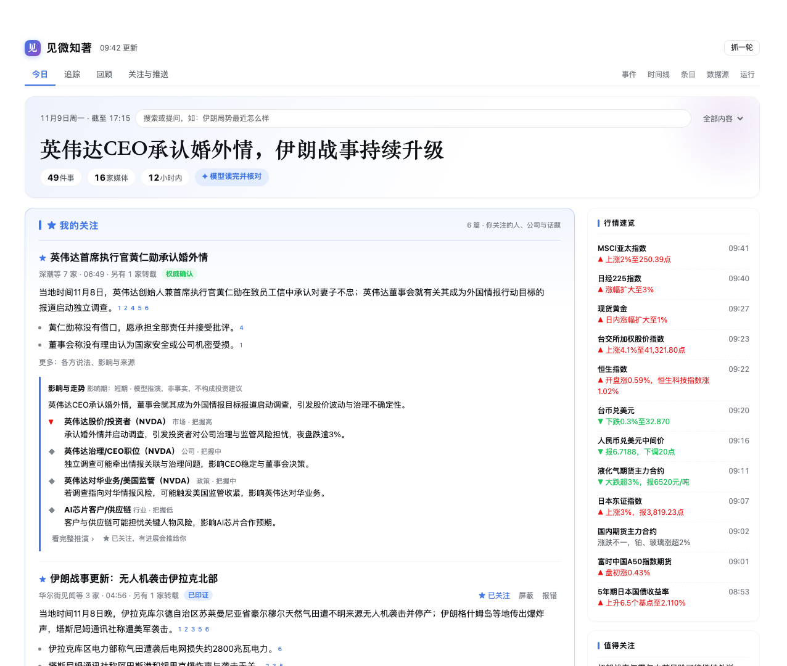
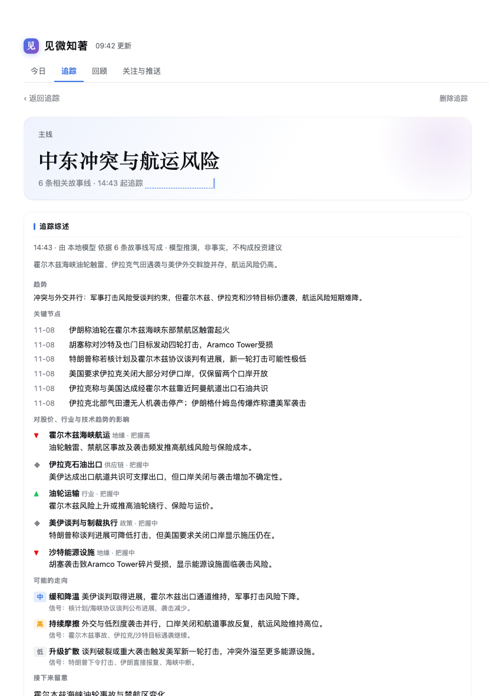
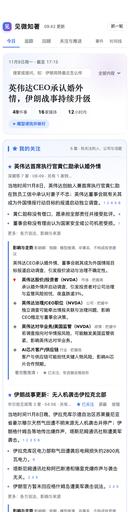

# 见微知著 · Newswire


> **See the small signs. Know where they lead.**
>
> Read less. Know more.

English | [中文](README.zh.md)

Hundreds of wire flashes a day, and maybe ten things you actually need to know. **见微知著** (*jiàn wēi zhī zhù*, a Chinese idiom: "from the small signs, know the whole") picks those ten, explains them, connects them, and works out where they are heading.

It is a plugin for DeepSeek Harness. It gathers news from dozens of Chinese and international outlets, has a language model read it all, and lays it out as a newspaper-style edition:

- one story per event, however many outlets carry it;
- every sentence cited and checked against its sources;
- what changed since your last visit, at the top;
- the companies, technologies and situations you care about tracked over time, with their likely effect on stocks, industries and technology trends;
- the top stories pushed to your phone at your pace, and a digest every evening.



---

## Why it exists

| The problem | What it does |
|---|---|
| Ten outlets run the same story, and you read it ten times | **One storyline per event**: reports are merged across outlets and across Chinese and English. Near-verbatim reposts are labeled and never count as independent confirmation. |
| A fluent model summary, and no way to tell if it's true | **Every sentence has a source**: each sentence names the reports it rests on. Numbers, foreign names and quoted words must appear in the source text, or the sentence is dropped. |
| Headline-only items, ads in the feed, gaps between fetches | **Complete, clean, continuous**: headline-only items get their full text from the original page; roundups are split into single items; ads and paywall teasers are filtered out. Each source resumes exactly where the last round stopped and pages back to close any gap. |
| You know what happened, not what it means | **Impact and outlook**: for major stories the model works out which markets, companies (with tickers) and industries are affected, two or three ways things could go, and the signals to watch. |
| You follow a company, and the news about it is scattered | **Tracking**: follow a company, a technology, a person or a theme. Related storylines attach automatically, and the model keeps an up-to-date synthesis: current state, trend, milestones, and what changed since last time. |
| Too many pushes and you mute it; too few and you miss things | **Pushes at your pace**: every 2 hours, three times a day, or the evening digest only. A story is pushed again only when it really moves, and sections you mark "not useful" get a higher bar automatically. |

## What it does

### 🗞 An edition you can actually read

The edition has top stories, your follows, sections, things to watch and items awaiting confirmation, with a markets box on the side. Each story has a lead, key points, who said what, and why it matters. The top tells you **what changed since your last visit**; click any headline for that story's full timeline.

### 🔭 Tracking, the flagship feature

News arrives one item at a time, but what you care about is usually a thread: what a company keeps shipping, who is pushing a technology forward, where a conflict is going.

- Add something to track (companies can carry a ticker). Related storylines attach automatically; detach a wrong one in one click.
- The model writes an **incremental synthesis** that reads only the newly attached reports, not the whole history every time:
  - current state and trend;
  - a timeline of milestones;
  - effects on stock prices, the industry and technology trends;
  - two or three possible paths, each with the signals that would confirm it;
  - what changed since the last synthesis.
- "Worth tracking" suggests subjects from recent coverage. Tracked subjects join your follows, so their developments are pushed to you.



### 📈 Impact and outlook

Major front-page stories are analyzed automatically, and any story has an "Analyze impact & outlook" button. The analysis covers:

- who is affected, for better or worse, through what mechanism, and with what confidence;
- base, escalation and de-escalation scenarios;
- the next milestones to watch.

Every claim is number-checked and marked as projection, not investment advice. If a story is worth following, one click follows its developments.

### 💬 Ask the news

Ask at the top, for example "what's the latest on Iran?" or "what happened with Nvidia this week?". It first searches your local news store, matching across names, so 英伟达 also finds Nvidia. The model then answers in time order, citing every sentence and saying so when the material isn't enough.

### 📱 Phone pushes and an evening digest

Pushes arrive through Telegram or Feishu. Each item has a headline, a lead, a source line such as "Cailian and 2 others · 10:31 · confirmed by an authority", and a link. Repeat pushes are tagged as progress or upgrade, and followed stories carry a ★.

The evening digest has a one-line summary, the day's main threads, what to watch tomorrow, and the day's numbers.

### 🧠 Deep on the model, light on tokens

- **Incremental by design**: news already grouped is never sent again, unchanged stories keep their copy, and a round with nothing new makes zero model calls.
- **Cache-friendly prompts**: fixed instructions come first and material last, so hosted models' prefix caches hit.
- **Measured concurrency**: it tests whether the model server can run requests in parallel and sets batch concurrency from that. A slow local GPU and a fast hosted API are both handled.
- **Three depth levels and a daily budget**: Lean, Balanced and Deep set how much is read, how much is written and how many stories are analyzed. You can cap tokens per day, and every call is logged.
- **The model learns, the program runs it**: for pages the generic parser can't read, the model reads the structure once and writes parsing rules, which run every round after a test fetch verifies them; when a redesign breaks them, they are relearned. The model's understanding costs tokens once, then every round is free, stable and can't invent links.
- **No model needed**: save-tokens mode makes no model calls at all and builds the same layout from rules. If any model step fails, it falls back to the rule result.

### 🛡 Credibility you can see

- Every event gets an importance score from 0 to 100, based on independent outlets, source weight, domestic and foreign coverage, source-side heat and follow-up speed.
- Every event gets a credibility label: **single source**, **corroborated**, **confirmed by an authority**, or **disputed** (outlets give conflicting figures).
- Readers can flag any sentence. It is withdrawn at once and avoided on the next rewrite.

### 🗂 Your data stays yours

News, article text, each outlet's heat curve, your follows and your feedback live in a local SQLite file. You can search it, browse it by day, and export it as a dataset. Exports list every gap and failed round, so downstream use never mistakes "not fetched" for "no news".

---

## Get started in three minutes

**0. Set up the fetch tools (one command)**

见微知著 fetches news through your logged-in Chrome, so the fetch tools come first. This command checks your setup and installs what is missing. Everything goes into your home directory, no sudo is needed, and it is safe to run again:

```bash
curl -fsSL https://raw.githubusercontent.com/heavenJiang/dsh-newswire/main/scripts/setup.sh | bash
```

| Tool | Made by | What it does here | Required? |
|---|---|---|---|
| **browse** | Anomaly (the opencode team) | Opens news pages in your logged-in Chrome and reads them; the main channel | **Required** |
| **Agent Reach** | Open-source community project | RSS parsing and web reading; the second channel | Recommended |
| **MCPorter** + **Exa** | OpenClaw / Exa Labs | Searches back for items a round missed | Recommended |

You need Node.js 22.19 or later (or 24+), and Python 3.10+ for Agent Reach. Without the last two the plugin still works; the affected sources fall back to direct requests. What each tool is, why it can be trusted and what data it touches are covered under [Built on these open-source projects](#built-on-these-open-source-projects).

<details>
<summary>Install by hand</summary>

```bash
npm install -g @opencode/browse && browse install        # add the Chrome extension and pair it
python3 -m venv ~/.agent-reach-venv && ~/.agent-reach-venv/bin/pip install https://github.com/Panniantong/Agent-Reach/archive/main.zip
npm install -g mcporter && mcporter config add exa https://mcp.exa.ai/mcp --scope home
```

browse also has an official installer: `curl -fsSL https://opencode.ai/browse/install | bash`. Install Agent Reach from GitHub; the package of the same name on PyPI is a different project. If the tools live somewhere unusual, set their paths in the plugin settings; by default they are detected automatically. Run `bash scripts/setup.sh --check` any time to check again.

</details>

**1. Install the plugin**

```bash
dsh plugin --profile web add github:heavenJiang/dsh-newswire
```

Or in the web UI, go to **Plugins → Add plugin** and enter `github:heavenJiang/dsh-newswire`. It is plain JavaScript with no dependencies and no build step. **Restart the harness** after installing.

**2. Open 见微知著 in the sidebar**

The first screen takes 30 seconds: pick sections, things to follow and a push cadence. Press Start and the first round runs. A rule-built edition appears as soon as the round finishes, and the model's stories replace it one by one.

**3. Push to your phone (optional)**

1. Ask the agent to "set up news pushes" (it calls `newswire_schedule_setup`). By default it runs every 2 hours from 07:00 to 21:00 Beijing time; the 07:00 round covers the night and is titled "Overnight".
2. After the first delivery, `/use` or `/watch` that conversation once in Telegram or Feishu. This needs a phone-channel plugin such as dsh-switchboard; this plugin does not depend on it.
3. For the evening digest, ask the agent to call `newswire_schedule_setup` with `kind: "daily"`.

Too many pushes? Say "push less" or "three times a day is enough" in chat, or adjust it under Follow & push.

**Updates**: Runs → Version checks GitHub for a new version and updates in place with one click.

## The panel

| Tab | What's there |
|---|---|
| **Today** | The edition, your follows, Ask, the markets box. Every story can be followed, muted, flagged or analyzed. |
| **Tracking** | Tracked subjects, suggestions, and each subject's synthesis and timeline |
| **Recap** | Daily digests, day by day |
| **Follow & push** | Followed and muted keywords, topics and sources; push cadence, thresholds, daily cap, push history with useful / not useful |
| Events · Timeline · Items | For digging deeper: filterable events with each outlet's report side by side, round-by-round history, every item with full-text search |
| Sources · Runs | One-click add with a test fetch first, each source's scorecard and on / trial / off; model, depth, usage, schedules, continuity and failures, version updates |

The panel follows the harness's light and dark themes and works at phone width.



## Sources

33 sources ship in two packs. You can add, edit and test-fetch sources from the panel. Only the 17 that scored best in testing are on by default: in the core pack Cailian, Jiemian, Wallstreetcn, 36Kr, The Paper, Xinhua, gov.cn, Reuters, BBC and FT, plus the official study-abroad sources. The other 15 start on trial: they are fetched and corroborate other reports, but never lead a story or a push on their own. DW Chinese starts off. The edition stays clean without losing corroboration.

| Pack | Region | Sources |
|---|---|---|
| core | China | Cailian Telegraph, TechFlow, Caixin, Yicai, Jiemian, The Paper, Securities Times, Wallstreetcn, Xinhua politics, gov.cn, China News, Guancha tech, 36Kr |
| core | International | Reuters, AP World / Business, BBC, New York Times, The Guardian, FT, Dow Jones, Al Jazeera, DW Chinese, South China Morning Post |
| study_abroad | China | CSCSE (notices, news), Ministry of Education, China Scholarship Council |
| study_abroad | International | UK Visas and Immigration, IRCC Canada, USCIS, The PIE News, ICEF Monitor |

**Want another source?** On the Sources tab, click "+ Add a source", enter a name and an RSS feed or news list page URL, test-fetch to see what comes back, then add it. Type (RSS or list page), region and id are worked out for you, and new sources start on trial.

**A page the generic parser can't read** (an account's posts on X, say)? Click "Let the model learn this page": the model reads the page structure once and writes parsing rules, a test fetch verifies them right away, and if they fail the model gets the results and tries again. Once learned, the program follows the rules every round with no model calls. In testing, a local model learned an X feed in about 40 seconds, with an exact time on every post. On Balanced and Deep, a source that parses nothing two rounds in a row (usually a site redesign) is relearned in the background.

**Not sure a source is worth it?** The Sources tab gives each one a scorecard: front-page stories, first reports, exclusives, corroborations, share of low-value items, completeness and fetch success. It also recommends on, trial or off. A source on trial only corroborates others and never leads a story or a push on its own.

**Study abroad** is a separate pack with its own pushes at 08:30 and 20:30. It covers only visas and immigration, institutions, admissions, language tests, scholarships and work abroad, and can go to a different chat.

**Fetching**: each source tries several channels in order: your logged-in Chrome (browse), then agent-reach, then a direct request. Every failure is recorded with its reason. Verification pages and login walls are never bypassed.

## Built on these open-source projects

见微知著 doesn't reinvent crawling. Fetching is handed to a few well-established open-source tools, all MIT-licensed and maintained in the open on GitHub, so you can read their code and docs yourself.

### browse: your own browser, driven by a program

[](https://github.com/anomalyco/browse) [](https://www.npmjs.com/package/@opencode/browse)

- **What it is**: in its own words, "Let your AI agents use your real browser: your tabs, your logins, your extensions." It is an MCP server plus a browser extension, and works in Chrome, Edge, Brave, Arc, Vivaldi, Opera and Chromium.
- **Who makes it**: [Anomaly](https://anoma.ly), the team behind the open-source coding agent [opencode](https://opencode.ai). The npm package is `@opencode/browse`, and the official installer is hosted on opencode.ai.
- **Why it's used**: many news sites, Cailian among them, return an empty shell or a verification page to plain requests. A real browser sees what you see. Pages open in a background tab group, away from the tabs you're reading.
- **Safety**: the local relay listens only on this computer (127.0.0.1) by default, the extension must be paired before it connects, and your logins stay in your browser. 见微知著 skips captchas and login walls; it never tries to get around them.

### Agent Reach: RSS and web reading

[](https://github.com/Panniantong/Agent-Reach)

- **What it is**: "Give your AI agent eyes to see the entire internet." One CLI for reading web pages, reading RSS and searching, which picks, installs and health-checks the most reliable way into each platform. It has been GitHub Trending's #1 repository of the day.
- **What it does here**: parses RSS (it ships with feedparser) and reads pages through whichever web-reading backend it currently has. AP, CSCSE and some other sources use it.
- **Safety**: it lives in its own `~/.agent-reach-venv`, separate from the system Python, and the setup script installs only the CLI; it never logs you in anywhere. Install it from GitHub; the PyPI package of the same name is a different project. When its web backend is Jina Reader, page URLs are sent to Jina's service.

### MCPorter and Exa: getting back what was missed

[](https://github.com/openclaw/mcporter) [](https://github.com/exa-labs/exa-mcp-server)

- **MCPorter**: from the team behind the open-source personal AI assistant [OpenClaw](https://openclaw.ai). It discovers and calls MCP servers from the command line and from scripts ([docs](https://mcporter.sh)). 见微知著 uses it to call Exa.
- **Exa**: [Exa Labs](https://exa.ai), "the search engine for AI". Its official hosted MCP server (`https://mcp.exa.ai/mcp`) works anonymously with rate limits; for higher limits, get an API key from Exa.
- **What it does here**: when a source can't connect to the last round and paging back doesn't close the gap, it searches for the missing items by source name, domain and time range. It's a fallback and rarely runs. Exa receives only that search query, nothing about you.

---

## Reference

<details>
<summary><b>Tools (callable by the agent in chat)</b></summary>

| Tool | Purpose |
|---|---|
| `newswire_edition` | The latest edition; `refresh=true` rebuilds it in the current mode |
| `newswire_daily` | Today's digest: summary, main threads, what to watch, the day's numbers |
| `newswire_story` | Everything about one storyline: current copy, every report, every update, push history |
| `newswire_track` | Tracking: list, add (company / technology / person / theme, optional ticker), get, rewrite the synthesis, remove |
| `newswire_analyze` | Impact and outlook analysis for one storyline |
| `newswire_follow` | Follow or mute storylines, keywords, topics and sources |
| `newswire_push_prefs` | Push cadence, thresholds, per-round and daily caps ("push less") |
| `newswire_schedule_setup` | Create, show, pause, resume or delete the push or digest schedule; `pack` picks the pack |
| `newswire_cycle` | The scheduled round: fetch → group and score → fetch bodies → pick → return the message |
| `newswire_run` | Fetch one round without pushing |
| `newswire_events` / `newswire_event` | Query events; one event's reports, score history, pushes and disputes |
| `newswire_items` | Stored items by category, source, label, full-text query and time window |
| `newswire_snapshot` | The latest round at a glance: data time, hot terms, failures with fixes, top events |
| `newswire_sources` / `newswire_source_test` / `newswire_source_upsert` / `newswire_source_toggle` / `newswire_source_remove` | View, test-fetch, add or edit, enable or disable, and remove sources |
| `newswire_failures` | One round's failed attempts with suggested fixes |
| `newswire_reprocess` | Recompute labels and events after editing the taxonomy or body rules |
| `newswire_export` | Export a dataset for a date range |

</details>

<details>
<summary><b>Settings</b></summary>

Plugin settings:

```yaml
dataDir: ~/.dsh/newswire        # sources, taxonomy, database, raw snapshots, datasets
windowHours: 24
browseSession: news-ingest
timeoutMs: 600000               # limit for one fetch round
rawRetentionDays: 180           # raw snapshots are compressed after a day and deleted after this
bodyBudget: 12                  # article bodies fetched per round for top events; 0 turns it off
modelMode: llm                  # llm | economy; a choice made in the panel takes precedence
llmMaxItems: 150                # items the model reads per edition (overridden by the panel's depth)
llmStories: 16                  # stories written by the model
llmBudgetMs: 1500000            # time budget per edition; remaining steps use rule results
modelTimeoutMs: 180000          # timeout per model call
cycleBudgetMs: 540000           # longest a scheduled push round may take (the harness waits at most 10 minutes for a tool call)
browseBin: ''                   # empty = detect automatically; same for agentReachBin and mcporterBin
```

Model, depth (Lean / Balanced / Deep) and the daily token budget are set under Runs → Model; the model list comes from the harness.

Editable files in the data directory:

| File | Contents |
|---|---|
| `sources.json` | Sources, plus `push.<pack>` thresholds: 50 for multi-source events, 36 for single-source, at most 8 per round |
| `taxonomy.json` | 7 top-level and 29 second-level categories, 13 regions, cross-language entity aliases, noise rules |
| `layout.json` | Layout: section order, stories per section, style and length |

On upgrade, new sources, categories and rules are merged in, your edits are kept, and the old file is saved as a `.bak`.

</details>

<details>
<summary><b>Dataset export</b></summary>

Use `newswire_export`, or run `node engine/run.mjs --mode export --from 2026-11-01 --to 2026-11-07`. Output goes to `dataDir/datasets/`:

- `articles.jsonl`: every item, with body text (withheld for paywalled content), labels, region, event, and its heat in every round;
- `events.jsonl`: events, members, score history, pushes;
- `stories.jsonl` / `editions.jsonl` / `digests.jsonl`: storylines, editions (including the model's grouping and importance call for each item), digests;
- `manifest.json`: date range, sources and weights, component versions, and every **unfilled gap and failed round**.

The data model, SQL examples and heat signals are in [engine/README.md](engine/README.md).

</details>

<details>
<summary><b>Development</b></summary>

```bash
npm test               # unit tests, offline
npm run smoke:client   # panel components, theme variables, no duplicate keys in the API and copy tables
npm run eval           # quality eval: ad and ticker detection, roundup splitting, search, clustering; fails below baseline
npm run check          # all of the above plus syntax checks
npm run smoke          # integration: fake host, real fetching (needs network)
npm run preview -- --data <data dir>   # render the panel in a browser with real data
```

`npm run eval -- --llm <OpenAI-compatible URL>` also scores model grouping (pairwise precision / recall / F1).

</details>

## Notes and limits

- Every cited item names its source and time. Financial analysis is model projection and **not investment advice**.
- The model writes from headlines, summaries and fetched text, and can still be wrong. The panel says to check the original, and you can flag any sentence.
- On a slow local model, the first full edition takes over ten minutes. A rule-built edition shows in the meantime, and stories are swapped in as they are written. Later rounds are incremental and usually take a few minutes. Hosted models run in parallel automatically and are much faster.
- The harness waits at most 10 minutes for a tool call. With a slow model, the plugin **prepares the edition ahead of each scheduled push**, using how long recent editions actually took, so the push itself only adds the last few minutes. If time still runs short, it sends the edition the model has finished so far and keeps writing in the background for the next round.
- AP can only be fetched through browse. Reuters article text needs a login and is skipped as paywalled. agent-reach's web backend returns no time or heat and is used only as a fallback.

## Data and privacy

All data stays in your local data directory. LLM mode calls only the model you configured in the harness and picked in the panel, and sends headlines, sources, times, summaries and text excerpts. Apart from checking GitHub for updates, the plugin uploads nothing.

## License

MIT
