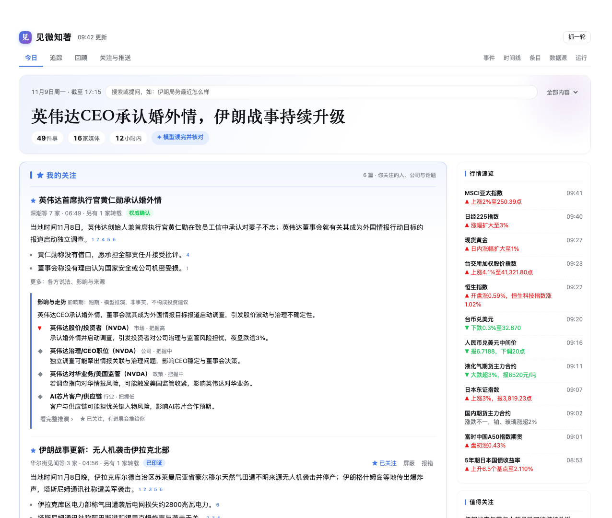
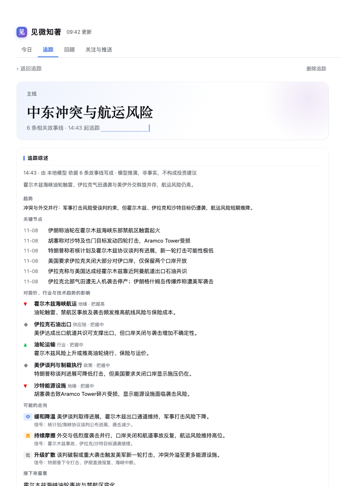

# 见微知著


> **从一条快讯，看见一个趋势。**
>
> 少看一点，多懂一些。

[English](README.md) | 中文

每天几百条快讯刷不完，真正值得知道的也许只有十件事。**见微知著**把它们挑出来、讲清楚、串起来，再推演接下来会怎样。

它是 DeepSeek Harness 的插件，替你从几十家中外媒体抓新闻，交给大模型读完，编成一份分栏报纸式的版面：

- 同一件事只看一条；
- 每句话都标出处，并由程序核对；
- 打开就知道上次之后变了什么；
- 你关心的公司、技术和局势会持续追踪，判断对股价、行业和技术走向的影响；
- 重点按你的节奏推到手机，每晚再给一份日报。



---

## 为什么用它

| 你烦的 | 见微知著的做法 |
|---|---|
| 同一件事十家在报，翻来覆去是一个意思 | **一件事一条故事线**：各家报道合成一条，中英文也能归到一起；几乎一字不差的转载单独标出，不冒充「多家印证」 |
| 模型总结得很顺，就是不知道真假 | **每句话都有出处**：句末标出依据的报道编号；数字、外文专名、引号里的词必须在原文里找得到，不过关的整句撤下 |
| 只有标题、广告混进来、快讯接不上 | **读全、去噪、不漏**：只有标题的先去原文补正文，合集自动拆成单条，广告和付费引流直接过滤；每个源从上一轮停下的地方接着抓，接不上就往回翻页补齐 |
| 知道发生了什么，不知道意味着什么 | **影响与走势**：重要新闻由模型推演会波及哪些市场、公司（附股票代码）和行业，给出两三种可能的走向和该盯的信号 |
| 关心一家公司，消息零零散散 | **追踪**：盯住一家公司、一项技术、一个人或一条主线，相关报道自动挂上，模型持续写综述：现状、趋势、关键节点、和上次比有什么变化 |
| 推送太多就关掉，太少又会漏 | **按你的节奏推**：每 2 小时、每天三次或只看日报；推过的不重复推，有了实质进展才再推；推送觉得「没用」的版块，门槛会自动调高 |

## 核心能力

### 🗞 一份真正能读的版面

今日要点、我的关注、各版块、值得关注、待核实，旁边是行情速览。每篇报道有导语、要点、各方说法和影响。顶部告诉你**自上次查看以来**的变化；点标题就能看这件事的完整时间轴。

### 🔭 追踪：本插件的主打功能

新闻是一条一条来的，但你关心的往往是一条线：一家公司接连发布了什么，一项技术哪些公司在推进，一场冲突走到了哪一步。

- 加一个追踪对象（公司可以附股票代码），相关故事线会自动挂上；挂错了可以一键摘掉。
- 模型写**增量综述**，只看新挂上的报道，不会每次重读全部历史：
  - 现状和趋势；
  - 关键节点时间轴；
  - 对股价、行业、技术趋势的影响；
  - 两三种可能的走向，以及每种走向该留意的信号；
  - 和上次相比有什么变化。
- 「值得追踪」会根据最近的报道主动推荐对象；你追踪的对象自动进「我的关注」，有进展就推给你。



### 📈 影响与走势

头版的重要新闻会自动做一次推演；任何一条也可以手动点「分析影响与走势」。结果包括：

- 谁会受影响，利好还是利空，传导逻辑是什么，把握有多大；
- 基准、升级、缓和等几种情景；
- 接下来值得留意的节点。

每条结论都会核对数字，并明确标注是推演、不构成投资建议。看完觉得值得跟，一键「关注这件事的进展」。

### 💬 问新闻

在顶部直接问，比如「伊朗局势最近怎么样」「英伟达这周有什么事」。它先在本地新闻库里检索（「英伟达」也能搜到 Nvidia 的报道），再由模型按时间讲清经过与各方说法。每句标出处，材料里没有的不编。

### 📱 推到手机，每晚一份日报

推送通过 Telegram 或飞书送达。每条有标题、导语、「财联社等 3 家 · 10:31 · 权威确认」这样的来源行和原文链接；再次推送的标【进展】或【升级】，你关注的带 ★。

每晚的日报有一句话总括、几条主线的「今日脉络」、明日关注和当日数字。

### 🧠 深度用模型，也省 token

- **只做增量**：已经归好的新闻不再交给模型，没变化的稿件直接沿用；没有新新闻时，一次模型调用都不发。
- **提示词缓存友好**：固定部分在前、材料在后，云端模型的前缀缓存能命中。
- **自动选并发**：先实测模型服务能不能并行，再决定同时跑几批。本地单卡慢模型和云端快模型都适用。
- **三档深度和每日预算**：「节省 / 均衡 / 深度」决定读多少、写多少、自动分析几篇；可以设每天的 token 上限，每次调用都记账。
- **「不限」档：所有网页都由模型读**：在「深度」之上，网页类的源每轮都由模型直接读页面，不靠任何解析规则，网站怎么改版都读得出。模型只能指认页面上真实存在的链接（链接按编号给它），标题和时间必须照抄页面，摘要由程序从原文截取；程序逐条核对，编出来的丢掉。不受每日 token 预算限制。RSS、接口和专用适配器读的是结构化数据，照常由程序处理。模型读不完的源（时间预算到了）、读失败的源，照常由程序抓。实测本地模型读一个页面约 1.5–2 分钟，适合少量网页源；云端快模型几秒一个页面，可以全部交给它。
- **让模型学会解析，程序照着执行**：通用解析认不出的页面，由模型读一遍结构写出解析规则，验证通过后交给程序每轮执行；网站改版导致解析失灵时自动重学。模型的理解只付一次 token，之后每轮零成本，结果稳定，也不会凭空编出链接。
- **不用模型也行**：「节省 token」模式完全不调用模型，由程序按规则编出同样结构的版面。模型任何一步出错，也会自动退回规则结果。

### 🛡 可信度看得见

- 每个事件都有 0–100 的重要度，综合看独立媒体数、源的权重、国内外是否同报、源头热度和跟进速度。
- 每个事件都有一个可信度标签：**单源**、**已印证**、**权威确认**或**存在分歧**（各家给的数字对不上）。
- 读者可以对任何一句报错，错句立即撤下，下次重写时会避开。

### 🗂 数据都在你手里

新闻、正文、各家的热度曲线、你的关注和反馈都存在本机 SQLite 里，可以全文搜索、按天回看，也能导出数据集用于训练或研究。导出时附带「哪些时段没抓全」的清单，下游不会把「没抓到」当成「没新闻」。

---

## 三分钟上手

**0. 准备抓取工具（一条命令）**

见微知著通过你已登录的 Chrome 抓新闻，所以先要装好抓取工具。下面这条命令会检查环境并装好需要的东西，全部装在用户目录，不需要 sudo，可以重复运行：

```bash
curl -fsSL https://raw.githubusercontent.com/heavenJiang/dsh-newswire/main/scripts/setup.sh | bash
```

| 工具 | 出品方 | 在这里做什么 | 必需吗 |
|---|---|---|---|
| **browse** | Anomaly（opencode 团队） | 用你已登录的 Chrome 打开新闻页并读取，是主力通道 | **必需** |
| **Agent Reach** | 开源社区项目 | RSS 解析与网页阅读，作为第二通道 | 推荐 |
| **MCPorter** + **Exa** | OpenClaw / Exa Labs | 漏抓时按时间段把新闻搜回来 | 推荐 |

需要 Node.js 22.19 以上（或 24 以上），装 Agent Reach 还需要 Python 3.10 以上。后两样没装，插件照常工作，只是对应的源会降级到直接请求。每个工具是什么、为什么可靠、会接触到哪些数据，见下方的[「站在这些开源项目上」](#站在这些开源项目上)。

<details>
<summary>想手动装</summary>

```bash
npm install -g @opencode/browse && browse install        # 装 Chrome 扩展并配对
python3 -m venv ~/.agent-reach-venv && ~/.agent-reach-venv/bin/pip install https://github.com/Panniantong/Agent-Reach/archive/main.zip
npm install -g mcporter && mcporter config add exa https://mcp.exa.ai/mcp --scope home
```

browse 也可以用官方安装脚本：`curl -fsSL https://opencode.ai/browse/install | bash`。Agent Reach 请从 GitHub 安装，PyPI 上的同名包不是同一个项目。三个命令装在特殊位置时，在插件设置里填路径即可；默认会自动探测。随时可以用 `bash scripts/setup.sh --check` 重新检查。

</details>

**1. 安装插件**

```bash
dsh plugin --profile web add github:heavenJiang/dsh-newswire
```

也可以在 Web 界面 **插件 → 添加插件** 填 `github:heavenJiang/dsh-newswire`。插件是纯 JavaScript，零依赖、无需构建。安装后**重启 harness**。

**2. 打开侧栏「见微知著」**

第一次打开先花 30 秒选：想看的版块、关注的词、推送节奏。点「开始」就抓第一轮，抓完马上出程序排的版面，模型写好一篇就替换一篇。

**3. 推到手机（可选）**

1. 对 Agent 说「帮我设置新闻推送」（它会调用 `newswire_schedule_setup`）。默认北京时间 07:00–21:00 每 2 小时一轮；07:00 那轮覆盖夜间，标题为「隔夜要闻」。
2. 第一次投递后，在 Telegram 或飞书里对这个会话 `/use` 或 `/watch` 一次。这一步需要一个手机通道插件，例如 dsh-switchboard；本插件本身不依赖它。
3. 想每晚收日报，再让 Agent 调用 `newswire_schedule_setup` 并传 `kind: "daily"`。

**直接推送（装了 dsh-switchboard 0.5.23 及以上时自动启用）**：switchboard 提供 `phonePush` 服务时，本插件按定时任务的时间自己抓取、写版面，写完直接把消息发到 switchboard 里接收定时任务结果的聊天（`scheduleChats`），不经过定时任务里的模型。模型转发长消息时会改写、漏发，甚至把乱码发到手机，直接推送就没有这个问题。这期间宿主里的定时任务显示为"暂停"，时间仍以它为准：在面板里改节奏，照样改的是这个任务。switchboard 卸载、关了"允许其他插件发消息到手机"，或在面板把推送方式改成"经定时任务"，就自动恢复定时任务，回到原来的方式。两个插件互不依赖。

嫌推得多，在对话里说「推少一点」或「一天三次就行」即可，也可以在面板「关注与推送」里调。

**更新**：面板「运行 → 版本」会到 GitHub 检查新版本，点一下就能原地更新。

## 面板一览

| 页签 | 内容 |
|---|---|
| **今日** | 版面、我的关注、问新闻、行情速览；每篇报道可以关注、屏蔽、报错、分析影响 |
| **追踪** | 追踪对象、值得追踪的建议、每个对象的综述与时间轴 |
| **回顾** | 每天的日报，可以按天翻看 |
| **关注与推送** | 关注 / 屏蔽的关键词、主题、来源；推送节奏、门槛、每天上限、推送记录与「有用 / 没用」 |
| 事件 · 时间线 · 条目 | 给想深挖的人：可筛选的事件列表与各家报道对照、按天按轮回看、全部快讯与全文检索 |
| 数据源 · 运行 | 一键添加新源（先试抓预览）、每个源的成绩单与开 / 试用 / 关；模型、深度、用量、定时任务、衔接与失败明细、版本更新 |

面板跟随 harness 的明暗主题，手机宽度下也好用。


## 数据源

预置 33 个源，分两组，可以在面板里增删改、试抓。默认只开实测质量最好的 17 个（核心包的财联社、界面、华尔街见闻、36氪、澎湃、新华网、中国政府网、路透、BBC、FT，以及留学包的官方来源），其余 15 个处于「试用」：照常抓取、帮别家印证，但不单独上版或推送；德国之声中文默认关闭。版面因此更干净，多一家印证也不会少。

| 主题包 | 区域 | 源 |
|---|---|---|
| core | 国内 | 财联社电报、深潮 TechFlow、财新、第一财经、界面快讯、澎湃首页、证券时报、华尔街见闻、新华网时政、中国政府网、中新网、观察者网科技、36氪快讯 |
| core | 国际 | 路透、美联社 World / Business、BBC、纽约时报、卫报、FT、道琼斯、半岛电视台、德国之声中文、南华早报 |
| study_abroad | 国内 | 教育部留学服务中心（通知公告、新闻动态）、教育部工作动态、国家留学基金委 |
| study_abroad | 国际 | 英国 UKVI、加拿大 IRCC、美国 USCIS、The PIE News、ICEF Monitor |
| core | 海外技术（默认关闭） | Hacker News、OpenAI News、Simon Willison、Hugging Face、NVIDIA 技术博客、vLLM、Lil'Log、Ahead of AI、Interconnects、GitHub Blog |

**海外技术源**默认关闭，在「数据源」页打开。Hacker News 用「社区讨论」读法：只收 100 分以上的帖子，链接是帖子指向的原文，分数最高的 8 条再读讨论页取顶层评论，写成「社区观点」；它是讨论不是报道，不算独立信源，也不进「待核实」。技术博客用「技术长文」读法，写技术要点、背景和可借鉴之处。这些源都用 browse 读；英文页面读的是服务器给的原始 HTML，不受浏览器自动翻译影响。

**想加一个源？** 在「数据源」页点「＋ 添加数据源」，填名称和 RSS 或新闻列表页地址，先试抓看能抓到什么，满意再添加。类型（RSS / 列表页）、地区和 id 会自动判断，新源先进「试用」。

**通用解析认不出的页面**（比如 X 上某个账号的帖子流），试抓后会自动让模型来学（也可以点「让模型学会解析这个页面」重学）：模型读一遍页面结构，写出解析规则，程序马上试抓验证，不过关就带着结果让模型再改一次。学会后每轮都由程序照着规则抓，不再调用模型。实测本地模型 40 秒左右就能学会 x.com 的帖子流，抓回的每条都带准确的发布时间。「均衡」和「深度」档下，已有的源如果连续两轮一条都解析不出来（多半是网站改版了），会在后台自动重新学一次。

**不确定某个源值不值得开？** 「数据源」页给每个源一张成绩单：上版数、首报、独家、印证别家、低价值占比、内容完整度、抓取成功率，并给出「开 / 试用 / 关」的建议。试用中的源只用来印证别家，不单独上版或推送。

**留学资讯**是一组独立的源和推送：每天 08:30 和 20:30 各推一次，只推签证与移民、院校、申请、语言考试、奖学金、海外就业相关的事件，可以发到另一个聊天。

**抓取方式**：每个源按顺序尝试几条通道，先用你已登录的 Chrome（browse），再用 agent-reach，最后直接请求，哪一步为什么失败都会记录。验证页和登录墙一律不绕过。

## 站在这些开源项目上

见微知著自己不造爬虫轮子，抓取交给几个口碑成熟的开源工具。它们都是 MIT 许可、在 GitHub 上公开维护，你可以直接去看它们的代码与文档。

### browse：让程序用你自己的浏览器

[](https://github.com/anomalyco/browse) [](https://www.npmjs.com/package/@opencode/browse)

- **是什么**：官方的介绍是「让你的 AI Agent 使用你真实的浏览器：你的标签页、你的登录、你的扩展」，形式是一个 MCP 服务加一个浏览器扩展。支持 Chrome、Edge、Brave、Arc、Vivaldi、Opera 和 Chromium。
- **谁做的**：[Anomaly](https://anoma.ly)，也就是开源编程 Agent [opencode](https://opencode.ai) 背后的团队。npm 包名是 `@opencode/browse`，官方安装脚本也放在 opencode.ai 上。
- **为什么用它**：很多新闻站点（比如财联社）对普通请求只返回空壳或验证页，用真实浏览器才能看到和你一样的内容。它在后台的标签组里打开页面，不打扰你正在看的标签。
- **安全边界**：本地中转服务默认只监听本机（127.0.0.1），扩展要配对才能连接，登录状态始终留在你的浏览器里。遇到验证码或登录墙，见微知著一律跳过，不会尝试绕过。

### Agent Reach：RSS 与网页阅读

[](https://github.com/Panniantong/Agent-Reach)

- **是什么**：「让 AI Agent 够得着它自己上不去的互联网」。它把读网页、读 RSS、搜索等能力整合成一个命令行，替你挑好、装好、体检好每个平台当前最稳的接入方式。曾登上 GitHub Trending 当日第一。
- **在这里做什么**：解析 RSS（自带 feedparser），并用它当前可用的网页阅读后端读取页面。美联社、教育部留学服务中心等源会用到。
- **安全边界**：装在独立的 `~/.agent-reach-venv`，不影响系统 Python；安装脚本只安装命令行本身，不会替你登录任何平台。请从 GitHub 安装，PyPI 上的同名包不是这个项目。网页阅读后端是 Jina Reader 时，页面地址会发给 Jina 的服务。

### MCPorter 与 Exa：漏了能搜回来（默认关闭）

[](https://github.com/openclaw/mcporter) [](https://github.com/exa-labs/exa-mcp-server)

- **MCPorter**：开源个人 AI 助手 [OpenClaw](https://openclaw.ai) 团队出品，用来在命令行和脚本里发现、调用 MCP 服务（[文档](https://mcporter.sh)）。见微知著用它调用 Exa。
- **Exa**：[Exa Labs](https://exa.ai) 的「为 AI 打造的搜索引擎」。官方托管的 MCP 服务（`https://mcp.exa.ai/mcp`）可以匿名使用，有频率限制；需要更高额度时，可以在 Exa 官网申请 API Key。
- **在这里做什么**：某个源这一轮接不上上一轮、翻页也补不回来时，按「源名称 + 域名 + 时间段」搜回漏掉的单篇新闻。发给 Exa 的只有这条搜索词，不含你的任何个人信息。
- **默认关闭**（1.1.17 起）：Exa 是收费接口，缺口主要靠翻页补。要用的话，在那个源的配置里写 `"backfill": true`。

---

## 参考

<details>
<summary><b>工具（对话里 Agent 可调用）</b></summary>

| 工具 | 作用 |
|---|---|
| `newswire_edition` | 最新版面；`refresh=true` 按当前模式重新编排 |
| `newswire_daily` | 当天的日报（总括、主线脉络、明日关注、当日数字） |
| `newswire_story` | 一条故事线的全部：当前稿件、每篇报道、每次进展、推送记录 |
| `newswire_track` | 追踪：列出、添加（公司 / 技术 / 人物 / 主线，可附股票代码）、查看、重写综述、删除 |
| `newswire_analyze` | 对一条故事线做影响与走势分析 |
| `newswire_follow` | 关注 / 屏蔽故事线、关键词、主题、来源 |
| `newswire_push_prefs` | 推送节奏、门槛、每轮与每天上限（「推少一点」） |
| `newswire_schedule_setup` | 创建、查看、暂停、恢复、删除定时推送或日报任务；`pack` 选主题包 |
| `newswire_cycle` | 定时任务用的整轮：抓取 → 归并打分 → 补正文 → 选重点 → 返回要发的文字 |
| `newswire_run` | 只抓一轮，不推送 |
| `newswire_events` / `newswire_event` | 按条件查事件；单个事件的各家报道、打分轨迹、推送记录、分歧 |
| `newswire_items` | 按分类、来源、标签、全文检索、时间窗取已存新闻 |
| `newswire_snapshot` | 最近一轮的概况：数据时间、热点词、失败与处理建议、重点事件 |
| `newswire_sources` / `newswire_source_test` / `newswire_source_upsert` / `newswire_source_toggle` / `newswire_source_remove` | 数据源的查看、试抓、增改、启停、删除 |
| `newswire_failures` | 某一轮的失败尝试与处理建议 |
| `newswire_reprocess` | 改了分类或正文规则后，重算时间窗内的标签与事件 |
| `newswire_export` | 导出一段日期的数据集 |

</details>

<details>
<summary><b>设置</b></summary>

插件设置：

```yaml
dataDir: ~/.dsh/newswire        # 数据源、分类、数据库、原始快照、数据集
windowHours: 24
browseSession: news-ingest
timeoutMs: 600000               # 一轮抓取的上限
rawRetentionDays: 180           # 原始快照一天后压缩，超过此天数删除
bodyBudget: 12                  # 每轮为重点事件抓正文的篇数；0 关闭
modelMode: llm                  # llm | economy；面板里选过的以面板为准
llmMaxItems: 150                # 每份版面交给模型阅读的条数（面板「深度」会覆盖）
llmStories: 16                  # 由模型写稿的篇数
llmBudgetMs: 1500000            # 一份版面的时间预算，超出后其余步骤用规则结果
modelTimeoutMs: 180000          # 单次模型调用超时
cycleBudgetMs: 540000           # 定时推送每轮最多用多久（宿主对一次工具调用最多等 10 分钟）
browseBin: ''                   # 留空自动探测；agentReachBin、mcporterBin 同理
```

模型、深度（节省 / 均衡 / 深度）和每日 token 预算在面板「运行 → 模型」里设，模型列表来自 harness。

数据目录里还有几份可编辑的配置：

| 文件 | 内容 |
|---|---|
| `sources.json` | 数据源，以及 `push.<主题包>` 推送门槛：多源事件 50、单源 36、每轮最多 8 条 |
| `taxonomy.json` | 7 个一级、29 个二级分类，13 个地区，跨语言实体别名，噪声规则 |
| `layout.json` | 版式：版块顺序、每版篇数、写法与字数 |
| `profiles/<id>/` | 读法（可选）：某类报道怎么评分、怎么写、影响分析看什么。内置「新闻」和「AI 与新技术」两种；放一个同名目录就覆盖内置的，也可以新增。格式见 [engine/README.zh.md](engine/README.zh.md#读法profile) |

插件升级时，新的源、分类和规则会合并进来，你改过的内容会保留，旧文件留作 `.bak` 备份。

</details>

<details>
<summary><b>数据集导出</b></summary>

用 `newswire_export`，或运行 `node engine/run.mjs --mode export --from 2026-11-01 --to 2026-11-07`。导出到 `dataDir/datasets/` 下：

- `articles.jsonl`：每条新闻，含正文（付费内容不导出正文）、标签、地区、所属事件和每一轮的热度；
- `events.jsonl`：事件、成员、打分轨迹、推送记录；
- `stories.jsonl` / `editions.jsonl` / `digests.jsonl`：故事线、版面（含模型对每条新闻的归类与重要度判断）、日报；
- `manifest.json`：时间范围、数据源与权重、各组件版本，以及**未补全的缺口和失败的轮次**。

数据模型、SQL 示例和热度信号见 [engine/README.zh.md](engine/README.zh.md)。

</details>

<details>
<summary><b>开发</b></summary>

```bash
npm test               # 单元测试，离线
npm run smoke:client   # 面板组件、主题变量、接口表与文案表无重复键
npm run eval           # 质量评测：广告与行情判定、合集拆条、搜索、聚类，低于基线即失败
npm run check          # 以上全部加语法检查
npm run smoke          # 集成测试：假宿主挂载插件、真实抓取（需联网）
npm run preview -- --data <数据目录>   # 在浏览器里用真实数据渲染面板
```

`npm run eval -- --llm <OpenAI 兼容地址>` 另外评测模型归并（成对精确率 / 召回率 / F1）。

</details>

## 口径与限制

- 引用新闻会标明来源和时间。财经相关的分析是模型推演，**不构成投资建议**。
- 模型依据标题、摘要和抓到的正文写作，仍可能出错。面板注明以原文为准，你也可以随手报错。
- 本地慢模型第一次编一份完整版面要十几分钟，期间先显示程序排的版面，写好一篇换一篇；之后每轮只做增量，通常几分钟。云端模型会自动并行，快得多。
- 宿主对一次工具调用最多等 10 分钟。模型慢时，插件会按最近几次的实际耗时，在每次定时推送前**提前抓取并编排**，到点只补增量；万一时间还是不够，就先推模型已经写好的版面，没写完的在后台继续，下一轮再推。
- 美联社只能用 browse 抓；路透正文需要登录，按付费墙跳过。agent-reach 的网页后端拿不到时间和热度，只作兜底。

## 数据与隐私

所有数据只存在本机的数据目录。LLM 模式只调用你在 harness 里配置、在面板里选中的模型，发送的是新闻标题、来源、时间、摘要和正文节选。除了检查更新时访问 GitHub，插件不上传任何数据。

## 许可证

MIT
