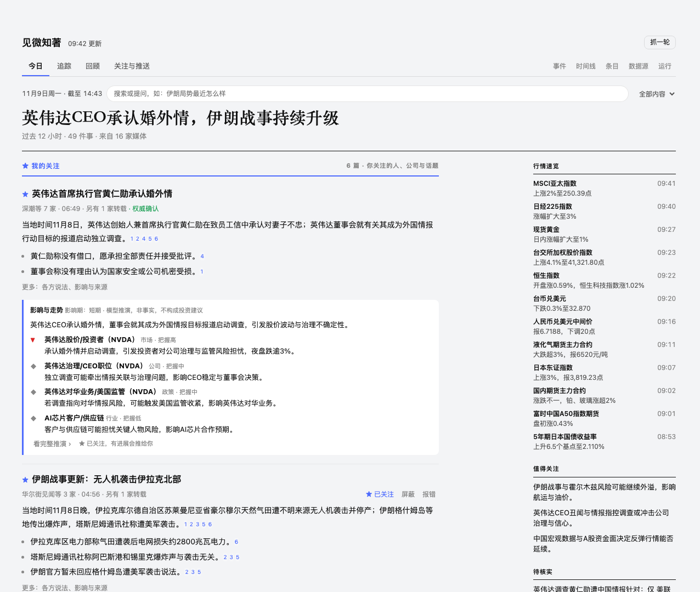
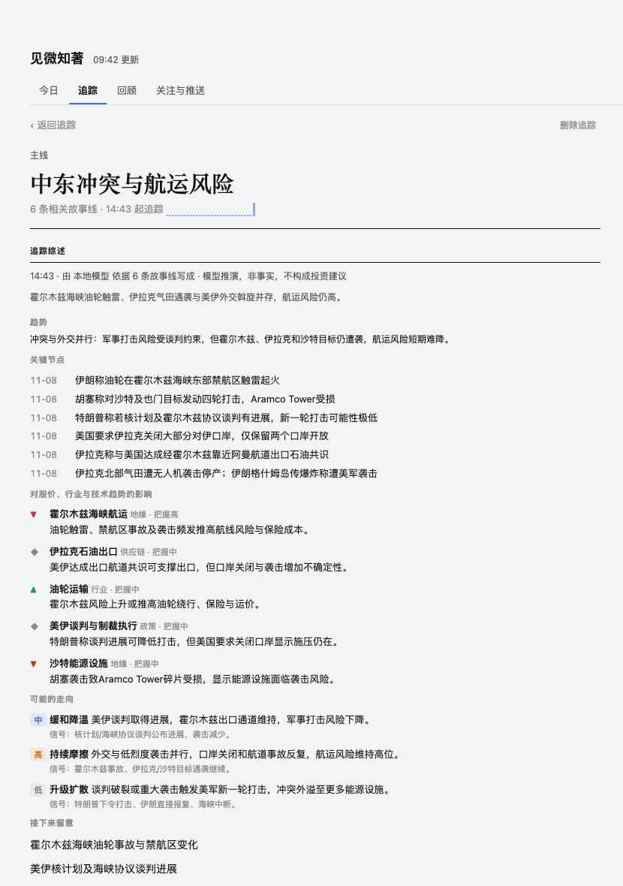
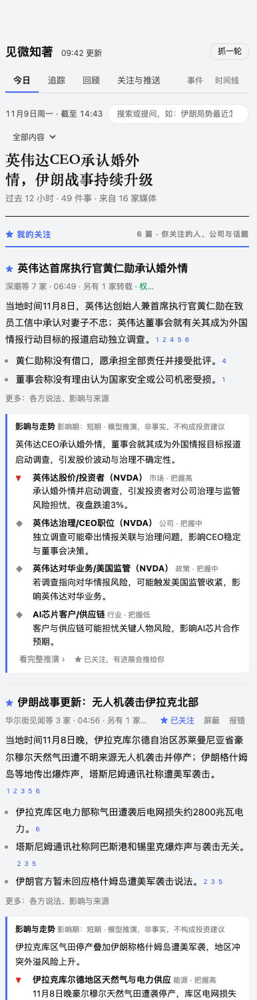

# 见微知著 · Newswire

**See the small signs. Know where they lead.** Read less, know more.

English | [中文](DETAIL.zh.md)

Hundreds of wire flashes a day, and maybe ten things you need to know. 见微知著 gathers news from dozens of Chinese and international outlets, has a language model read it all, and lays it out as a newspaper-style edition. You see one story per event, every sentence is cited and checked against its sources, and the top tells you what changed since your last visit. It tracks the companies, technologies and situations you care about, works out their likely effect on stocks, industries and technology trends, and pushes the important parts to your phone at your pace.

## What you get

- **One storyline per event**: reports are merged across outlets and across Chinese and English. Reposts are labeled and never count as corroboration.
- **Every sentence has a source**: numbers, foreign names and quoted words must appear in the source text, or the sentence is dropped.
- **Tracking**: follow a company, a technology, a person or a theme. Related storylines attach automatically, and the model keeps a synthesis up to date: current state, trend, milestones, effects on stocks, the industry and technology, possible paths, and what changed since last time.
- **Impact and outlook**: for major stories the model works out which markets, companies (with tickers) and industries are affected, the possible paths, and the signals to watch.
- **Ask the news**: ask "what's the latest on Iran?" and get a cited, time-ordered answer.
- **Complete, clean, continuous**: headline-only items get their full text, roundups are split into single items, and ads and paywall teasers are filtered out. Each source resumes exactly where the last round stopped.
- **Phone pushes and an evening digest**: every 2 hours, three times a day, or the digest only. A story is pushed again only when it really moves.
- **Deep on the model, light on tokens**: incremental processing, cache-friendly prompts and measured concurrency, with three depth levels and an optional daily budget. It can also run with no model at all.

## Four steps

1. **Set up the fetch tools**: run `curl -fsSL https://raw.githubusercontent.com/heavenJiang/dsh-newswire/main/scripts/setup.sh | bash` to install browse (required; fetches through your logged-in Chrome), agent-reach and Exa search (recommended). All are MIT-licensed open-source projects; see "Built on these open-source projects" in the README for each one's official background.
2. **Install** the plugin and restart the harness, then open 见微知著 in the sidebar.
3. **Spend 30 seconds** picking sections, things to follow and a push cadence, then press Start. An edition appears as soon as the first round finishes, and the model's stories replace it one by one.
4. **Push to your phone (optional)**:
   - ask the agent to "set up news pushes";
   - after the first delivery, `/use` or `/watch` that conversation once in Telegram or Feishu (this needs a phone-channel plugin such as dsh-switchboard);
   - for the evening digest, ask the agent to set it up again with `kind: "daily"`.

It ships with 33 sources: 24 in the core pack (Cailian, Jiemian, Wallstreetcn, The Paper, Xinhua, Reuters, BBC, FT and more) and 9 in the study-abroad pack (CSCSE, China Scholarship Council, UKVI, IRCC, USCIS and more). Only the 17 that scored best in testing are on by default; the rest start on trial, corroborating other reports without leading a story or a push on their own. The Sources tab gives each source a scorecard to help you decide whether to keep it on, put it on trial or turn it off.

The panel follows the harness's light and dark themes and works at phone width. Runs → Version updates the plugin in one click.

## Data and privacy

News, your follows and your feedback stay in your local data directory. LLM mode calls only the model you configured in the harness and picked in the panel. Paywalled text never goes into exported datasets, and verification pages and login walls are never bypassed. Financial analysis is model projection, not investment advice.

Tools, settings and the data model are in the [README](https://github.com/heavenJiang/dsh-newswire/blob/main/README.md).
