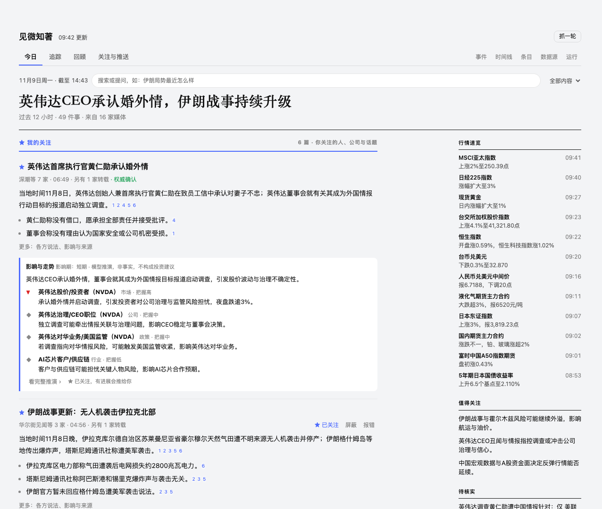
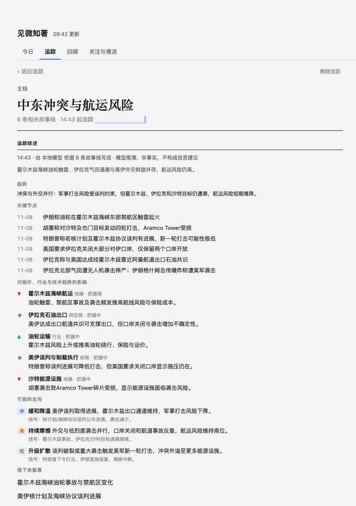
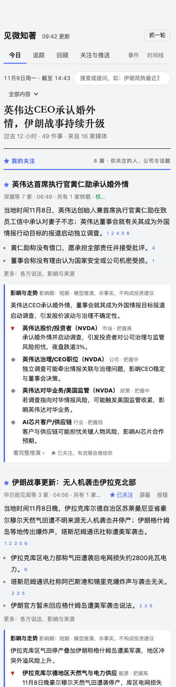

# 见微知著

**从一条快讯，看见一个趋势。** 少看一点，多懂一些。

[English](DETAIL.md) | 中文

每天几百条快讯，真正值得知道的也许只有十件事。见微知著替你从几十家中外媒体抓新闻，交给大模型读完，编成一份分栏报纸式的版面：同一件事只看一条，每句话都标出处并经过核对，打开就知道上次之后变了什么。你关心的公司、技术和局势，它会持续追踪，判断对股价、行业和技术走向的影响，并按你的节奏推到手机。

## 你会得到什么

- **一件事一条故事线**：各家报道合成一条，中英文也能归到一起；转载单独标出，不冒充多家印证。
- **每句话有出处**：句末标出依据的报道；数字、外文专名、引号里的词必须在原文里找得到，不过关的撤下。
- **追踪**：盯住一家公司、一项技术、一个人或一条主线，相关报道自动挂上。模型持续写综述，包括现状、趋势、关键节点、对股价 / 行业 / 技术趋势的影响、可能的走向，以及和上次比有什么变化。
- **影响与走势**：重要新闻自动推演会波及哪些市场、公司（附股票代码）和行业，给出几种可能的走向和该盯的信号。
- **问新闻**：直接问「伊朗局势最近怎么样」，按时间讲清经过与各方说法，每句标出处。
- **读全、去噪、不漏**：只有标题的去原文补正文，合集拆成单条，广告和付费引流直接过滤；每个源从上一轮停下的地方接着抓。
- **推到手机，每晚一份日报**：节奏可选每 2 小时、一天三次或只看日报；推过的不重复推，有实质进展才再推。
- **深度用模型，也省 token**：只做增量，提示词对缓存友好，按实测决定并发；三档深度，可设每日预算。也可以完全不调用模型。

## 四步用起来

1. **准备抓取工具**：运行 `curl -fsSL https://raw.githubusercontent.com/heavenJiang/dsh-newswire/main/scripts/setup.sh | bash`，装好 browse（必需，用你已登录的 Chrome 抓取）、agent-reach 和 Exa 搜索（推荐）。这几个都是 MIT 许可的开源项目，各自的官方介绍见 README 的「站在这些开源项目上」。
2. **安装插件**并重启 harness，在侧栏打开「见微知著」。
3. **花 30 秒选**想看的版块、关注的词和推送节奏，点「开始」。第一轮抓完马上出版面，模型写好一篇替换一篇。
4. **推到手机（可选）**：
   - 对 Agent 说「帮我设置新闻推送」；
   - 第一次投递后，在 Telegram 或飞书里对这个会话 `/use` 或 `/watch` 一次（需要手机通道插件，例如 dsh-switchboard）；
   - 想每晚收日报，再让 Agent 用 `kind: "daily"` 设置一次。

预置 33 个源：核心包 24 个（财联社、界面、华尔街见闻、澎湃、新华网、路透、BBC、FT 等），留学资讯包 9 个（教育部留学服务中心、国家留学基金委、英国 UKVI、加拿大 IRCC、美国 USCIS 等）。默认只开实测质量最好的 17 个，其余先「试用」：只帮别家印证，不单独上版或推送。「数据源」页给每个源一张成绩单，帮你决定开、试用还是关。

面板跟随 harness 的明暗主题，手机宽度下也好用。「运行 → 版本」可以一键更新。

## 数据与隐私

新闻、你的关注和反馈都只存在本机的数据目录。LLM 模式只调用你在 harness 里配置、在面板里选中的模型。付费文章的正文不会进入导出的数据集，验证页和登录墙一律不绕过。财经相关的分析是模型推演，不构成投资建议。

工具、设置和数据模型见 [README](https://github.com/heavenJiang/dsh-newswire/blob/main/README.zh.md)。
